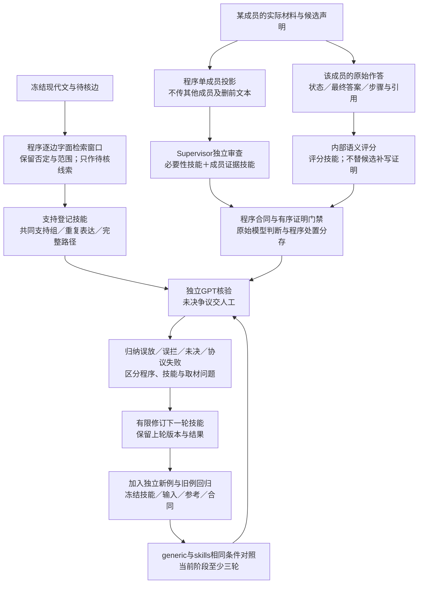
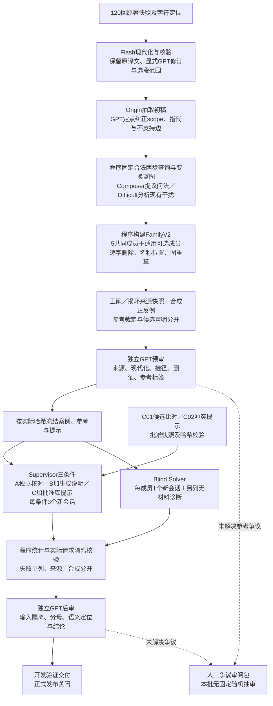
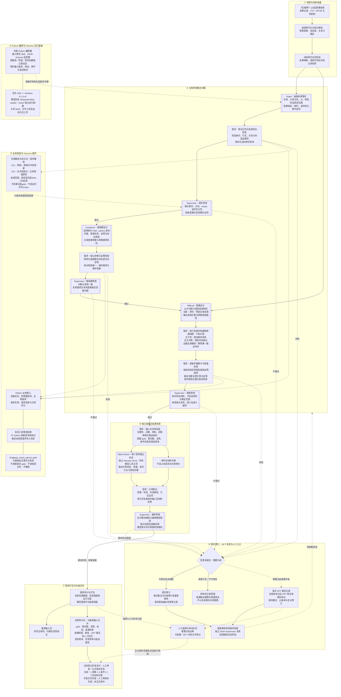

# 现有多智能体详细架构

版本：v0.4开发验证；日期：2026-10-22。FamilyV2共同5成员与适用的3类可选成员保持，质量修订增加[单成员审查与技能迭代](specs/skills-iteration-v0.4.md)；实际运行状态见[验证索引](validation/README.md)，家族规则见[删证与审查规范](specs/deletion-review-v0.2.md)。五角色仍由 Python 编排官方 Harness 的独立根会话，模型别名为 deepseek-flash，不能把角色名称视为独立模型。

## 新增质量层与迭代回路

上图是正在验证的质量层，非已证明可靠的自动放行系统。运行器只提供一个成员，家族变换不变量另由程序比较。评分角色可看待核参考声明，Blind Solver仍看不到标准答案。技能、检索窗口和结构门禁不能互相代替；前轮新例被用于修订后改称回归。实现入口见[质量模块](../src/quality_v3/README.md)。

## v0.2批次的数据与审核流程

本批并非端到端自主生成：程序／根GPT固定来源蓝图并记录修订，Composer与Difficult输出是受约束提案，不能据角色调用次数夸大自治程度。图求解只覆盖登记事实，自然文本的支持消失由独立预审核验。Supervisor与Blind Solver均关闭模型工具；库提示仅进入C条件，生成说明仅进入B/C，隐藏参考不进入任何实验输入。程序打包和独立审核不新增Flash角色。

## v0.1原型流程（保留作实现沿革）

下图描述先前单家族原型和插件验收路径，不代表本批逐阶段实际调用顺序，也不沿用其中旧的固定人工抽审要求。旧记录与人工状态保持原样；本批以[当前执行规范](specs/workflow.md)为准。

图中实线表示数据流与主要执行步骤，虚线表示调度、工具依赖、异常升级或回流。Supervisor 节点表示同一逻辑角色的不同独立审查回合；不是新增角色。所有常规角色共用 DeepSeek Flash，不共享构建上下文。材料现代化是前置准备，打包是程序步骤。

## 阅读边界

- 图上证明只覆盖已登记事实与规则；自然文本中的抽取遗漏、直接结论与语义捷径另行审查。
- 插件真实工具执行已验证。首批生成时曾发生插件未激活，不能声称该批模型已自主调用工具；修复后入口用于最终盲解与最终审查，详见[交付记录](validation/2026-10-21_五智能体最小贯通交付.md)。
- 当前三种完整材料条件答对，删证条件错误补出缺失关系。尚未证明实体混淆攻击成功；单例也不能支撑稳定能力结论。
- 时间、比较、集合、反事实生成、大批量调度与完整分层指标仍待实现。架构中的 GPT 为显式复核入口，不代表已部署自动 GPT API；人工队列存在不代表已完成抽审。

## 新增设计边界：外部核验与阶段性关系

用户已批准C01候选比对＋C02冲突提示。[报告与审批状态](resources/relationship-libraries/README.md)记录固定文件及使用范围，比对器在Origin独立抽取之后、Supervisor来源审查时提供线索；GPT修订事实后的来源复核也重算提示。适配器与调用位置已通过程序测试，未用新提示进行Flash实跑，详见[接入验证](validation/2026-10-21_关系库辅助核验接入.md)。不向Blind Solver开放知识库，不修改既有gold。

朋友／仇人及其他可变关系需附时间、事件、条件、方向与陈述者，不能在静态图中跨阶段任意拼接。合同与题型设计见[阶段性关系规范](specs/relationship-validation.md)；当前架构主图仍描述已实现的父母关系原型，不将待实现能力混作实测。
